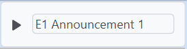

# Audio Element
The Audio element lets you play audio files in the table and customize how the audio track is played. The element in the table itself has an editable text label and a play button but using the tool bar gives you options to edit the playback and control the playback similar to a music player application.

{: .note }
The rewind and fast forward buttons are used by clicking and holding the mouse button down.

## Changing the track's start and end time
Using the "Start" and "End" combo box you can change when the audio track starts to play and when the playback ends. The start time is also applied on every repeat.

## Repeats
If the "Repeat on/off" button is activated the audio track is repeated x-times as set in the combo box. Repeats are reset after the last repeated playback. To immediately reset the repeats reopen the editor.

{: .note }
Changes to the repeat times number while a playback is running are only applied after.