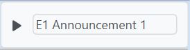

# Audio Element
The audio element plays an audio file from a cell. In the table it appears as a play button to start playback and a text label that you can rename. Open the element editor to see the full toolbar to customize the playback. There you can skip through the track, set a start and stop time, and repeat the audio.

Choose "Audio" from the **Add to cell menu** and select an audio file.\
Use the label to name the track, for example 'E1 Announcement 1'.

{: .note }
**Rewind** and **Fast forward** move continuously while you hold down the mouse button. The 5-second buttons jump once per click.

## Changing the track's start and stop time
Use the Start and Stop fields to play only part of a track. Playback begins at the start time and ends at the stop time. When the track repeats, each repeat also begins at the start time. Use the format "hours:minutes:seconds" (e.g. 1:05:30).

## Repeats
Turn on **Repeat on/off** to play the track several times in a row. Set the number of plays in the "Times repeating field" and the gap between plays in "Pause length". When the last repeat has finished, the count starts again from the beginning. To reset the repeats, close and reopen the element editor.

{: .note }
If you change the number of repeats while the audio is playing, the new value takes effect from the next playback.