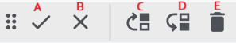

# Editing a cell 
Click a cell to open the cell editor. In the toolbar, click Add to cell (+) and choose the type of element to insert.

{: .note }
If possible choosing "From clipboard" inserts an element suitable for the clipboard content with the clipboard content.

## Editing elements

Clicking on an element opens the element editor and changes the options in the toolbar :\
**Save changes** (A): Saves changes to the element and closes the element editor.\
**Discard changes** (B). Discards all changes to the element and closes the element editor (Shortcut: Escape).\
**Move element up** (C): Moves the selected element up by one position in the cell.\
**Move element down** (D): Moves the selected element down by one position in the cell.\
**Remove element** (E): Removes selected element from cell.

{: .note }
You can also move elements by drag & dropping them to a different position in the cell or onto another another cell.

## Copying elements
You can copy elements and paste them into another cell or into a table of a different document. Chose "Copy" (Ctrl + C) under the menu "Edit" while the element editor is open. Open the cell editor of a different cell and paste with "Paste" (Ctrl + V).

{: .important }
Copying and pasting with the shortcut does not work with text elements. Use the menu instead.

