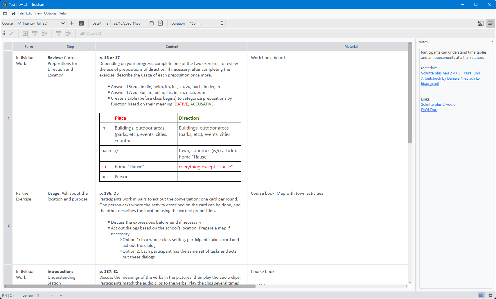

# Editing a document

### Contents

1. [Table](https://deatorfm.github.io/Teachart/table.html)
    1. [Editing cell contents](https://deatorfm.github.io/Teachart/editing_cell.html)
    2. [Elements](https://deatorfm.github.io/Teachart/elements.html)
    3. [View modes]()
2. [Notes]()
3. [Lesson information]()
4. [Presentation mode]()