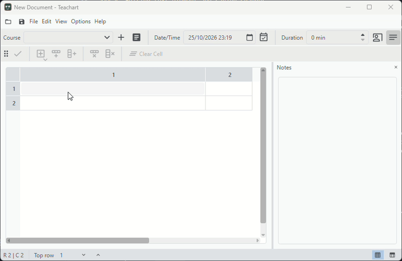
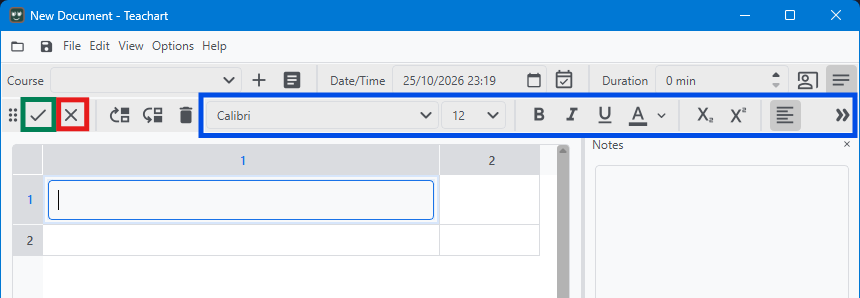
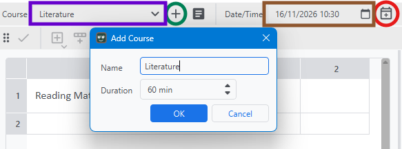

# Getting started
{: .fs-9 }

On this page you will learn the first basic steps to get an understanding of how this application works
What you will learn:
1. How to create a new document
2. Insert a text element into a cell and edit the text
3. Assign a course and set up a schedule 
4. Save the document

### 1. Make a new document
On application startup you will see the start window. Click on **New Sheet** and an editor with a blank table will open.

### 2. Adjusting the header size
You start off with a 2x2 grid. Let's make the columns wider by clicking and dragging to the right or left in the header section on the right end of a column.

{: .note }
Add more rows to the end by simply pressing Ctrl + R or columns using Ctrl + T.

### 3. Insert text into a cell
Click on the cell to activate cell edit mode. In the tool bar click on the  button and select text from the menu to insert a new empty text element. Click on the element to edit the element.

### 4. Editing text element and saving changes
You can now write formatted text like in a word processor using the **toolbar** at the top. When you are finished click on the **checkmark** button to save the changes and close the text editor. Click another time when you have finished editing the cell as well. You can also click on a free space in the table area or press Return (Ctrl + Return for the text editor) to confirm changes. You can discard the changes by pressing Escape or clicking **X** in the tool bar.

Try out the other options from the menu.

### 5. Adding a course and setting up a time schedule
Click on **+** next to the **course selection** and type in a course name and the lesson duration. You can now select the newly added course in the course selection. To schedule the lesson enter a **date and time** and click on the **schedule button**. The schedule is created when you save the file.

### 6. Save the file
Click on <svg xmlns="http://www.w3.org/2000/svg" height="18px" viewBox="0 -960 960 960" width="24px" fill="#4d5157"><path d="M840-680v480q0 33-23.5 56.5T760-120H200q-33 0-56.5-23.5T120-200v-560q0-33 23.5-56.5T200-840h480l160 160Zm-80 34L646-760H200v560h560v-446ZM565-275q35-35 35-85t-35-85q-35-35-85-35t-85 35q-35 35-35 85t35 85q35 35 85 35t85-35ZM240-560h360v-160H240v160Zm-40-86v446-560 114Z"/></svg> in the top left or select **Save** from the **File** menu.

Having learnt the basics to use the editor try out the other functions and browse through the docs to find out how to use them and to explore other features of Teachart.