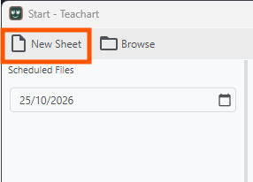
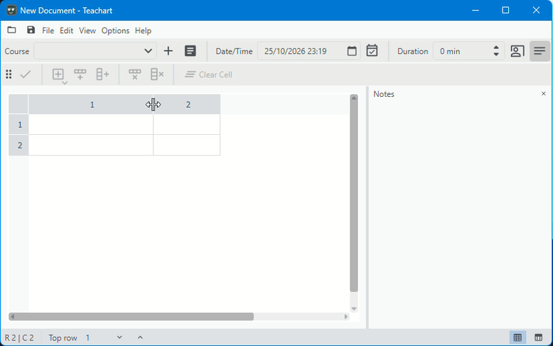

# Getting started
{: .fs-9 }

On this page you will learn the first basic steps to get an understanding of how this application works
What you will learn:
1. How to create a new document
2. Insert a text element into a cell and edit the text
3. Assign a course and set up a schedule 
4. Save the document

### 1. Make a new document
On application startup you cwill the start window. Click on **New Sheet** and the the editor with a blank editor will open.

### 2. Adjusting the header size
You can see an empty table with 2x2 grid . Let's make the columns wider by clicking and dragging to the right or left in the header section on the right end of a column.

### 3. Insert text into a cell
Click on the cell to activate cell edit mode. In the tool bar click on the  button and select text from the menu to insert a new empty text element. Click on the element to edit the element.

{: .note }
Add more rows to the end  by simply pressing Ctrl + R or columns using Ctrl + T.

### 4. Editing text element and saving changes
You can now write and format text like in a word processor using the toolbar at the top. When you are finished click on checkmark button two times to end element and cell edit mode and save the changes. You can also click on a free space in the table area or press Ctrl + Return 2-times. You can discard the changes by pressing Escape.

Try out the other options from the menu.

{: .important }
Make sure to have cell and element edit mode activated when you want to edit contents of a cell. A cell in edit mode is indicated by the highlighted border. The same applies for element edit mode.

### 5. Adding a course and setting up a time schedule
Click on + next to the course selection and type in a course name and course duration. You can now select the new course in the list. To schedule the lesson enter a date and time and click on the schedule button (marked in blue). The schedule will created when you save the file.

### 6. Save the file
Click on the "Save" icon in the top left or select "Save" from the "File" menu.

Having learnt the basics to use the editor try out the other functions of the editor and browse through the docs to find out how to use them.