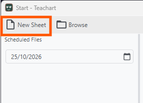
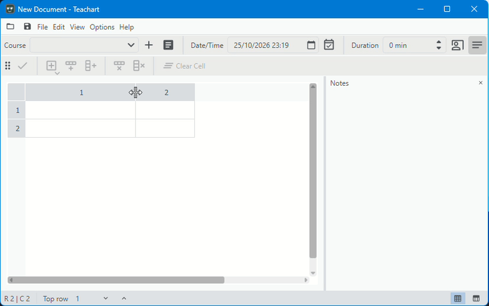
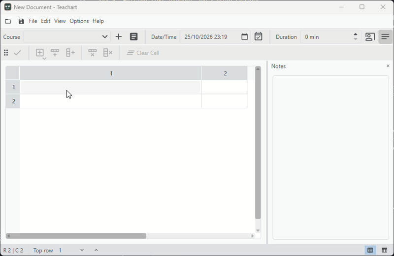
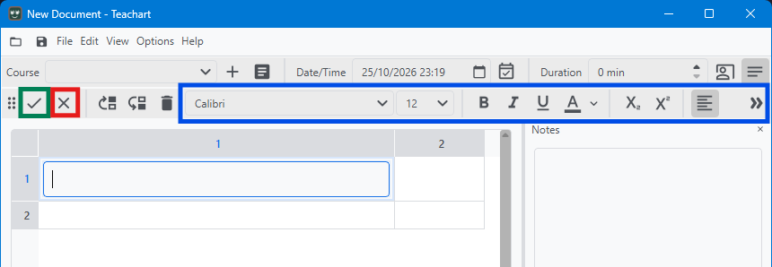
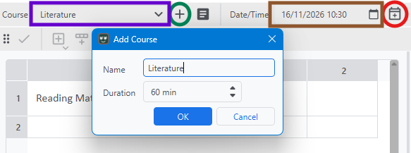

# Getting started
{: .fs-9 }

A Teachart document is a table (a sheet) for planning one lesson. Each cell holds one or more elements, such as formatted text. You can link a document to a course and a date and time. Teachart then lists it as a scheduled lesson on the start window. This page walks you through creating your first sheet. On this page you will learn the first basic steps to get an understanding of how this application works

What you will learn:
- How to create a new document
- Insert a text element into a cell and edit the text
- Assign a course and set up a schedule 
- Save the document

### 1. Make a new document
On application startup you will see the start window. Click on **New Sheet** and a new sheet opens in the editor. It starts with an empty 2×2 table.

### 2. Resize columns
Drag the right edge of a column header to make the column wider or narrower. The cursor changes to a resize arrow when you are in the right spot

{: .note }
Add more rows to the end by simply pressing Ctrl + R or columns using Ctrl + T.

### 3. Insert text into a cell
Click a cell to select it. In the toolbar, click the <svg xmlns="http://www.w3.org/2000/svg" height="18px" viewBox="0 -960 960 960" width="18px" fill="#e3e3e3"><path d="M440-280h80v-160h160v-80H520v-160h-80v160H280v80h160v160ZM200-120q-33 0-56.5-23.5T120-200v-560q0-33 23.5-56.5T200-840h560q33 0 56.5 23.5T840-760v560q0 33-23.5 56.5T760-120H200Zm0-80h560v-560H200v560Zm0-560v560-560Z"/></svg> button and choose Text. This adds an empty text element to the cell. Click the element to start typing..

### 4. Editing text element and saving changes
You can now write formatted text like in a word processor using the **toolbar** at the top. Click the **checkmark** button to confirm the text This closes the text editor. Click the checkmark again to finish editing the cell. You can also click on a free space in the table area or press Return (Ctrl + Return for the text editor) to confirm changes. You can discard the changes by pressing Escape or clicking **X** in the tool bar.

Try out the other options from the menu such as pictures or audio files.

### 5. Adding a course and setting up a time schedule
A course groups your lessons and sets the default lesson length.
1. Click **+** next to the **course selection**.
2. Enter a name and a duration, then click OK.
3. Select the new course in the course selection.
4. Enter the lesson's **date and time**, then click the **schedule button**.
The schedule is created when you save the file.

### 6. Save the file
Click on <svg xmlns="http://www.w3.org/2000/svg" height="18px" viewBox="0 -960 960 960" width="24px" fill="#4d5157"><path d="M840-680v480q0 33-23.5 56.5T760-120H200q-33 0-56.5-23.5T120-200v-560q0-33 23.5-56.5T200-840h480l160 160Zm-80 34L646-760H200v560h560v-446ZM565-275q35-35 35-85t-35-85q-35-35-85-35t-85 35q-35 35-35 85t35 85q35 35 85 35t85-35ZM240-560h360v-160H240v160Zm-40-86v446-560 114Z"/></svg> (Save) in the top left or select **Save** from the **File** menu and choose a location and a name.

You now know the basics: a sheet is a table of cells, cells contain elements, and a sheet can be linked to a course and scheduled. Explore the rest of the docs to learn about other element types and features.