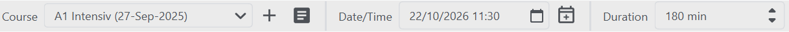

# Lesson info
Teacher who use Teachart to create lesson plans have the options to add different information about the lesson e.g. course name, date/time and duration. using the top tolbar.

## Selecting a course
Courses in the database can be assigned to a document by selecting an item from the combo box on the left. You can also search for a course by typing inthe course name or the name of the student assigned to the course. Quickly add a new your course with the + button or show the course's student list with <svg xmlns="http://www.w3.org/2000/svg" height="18px" viewBox="0 0 25 20" width="18px" fill="#e3e3e3"><path d="M0 0h24v24H0z" fill="none"/><path d="M19 3H5c-1.1 0-2 .9-2 2v14c0 1.1.9 2 2 2h14c1.1 0 2-.9 2-2V5c0-1.1-.9-2-2-2zm-5 14H7v-2h7v2zm3-4H7v-2h10v2zm0-4H7V7h10v2z"/></svg>.

{: .note}
If you select a course the course's default duration will be set automatically but you are still able to change it.

{: .note}
Opening a file with a course that is not in your database will prompt you add the course to your database.

## Schedules
If you set a schedule you can quickly open the document file from the start window on the set date and time. To do that set your desired date and time and click on "Schedule" <svg xmlns="http://www.w3.org/2000/svg" height="18px" viewBox="0 0 24 20" width="18px" fill="#e3e3e3"><path d="M0 0h24v25H0V0z" fill="none"/><path d="M19 3h-1V1h-2v2H8V1H6v2H5c-1.1 0-2 .9-2 2v14c0 1.1.9 2 2 2h14c1.1 0 2-.9 2-2V5c0-1.1-.9-2-2-2zm0 16H5V9h14v10zM5 7V5h14v2H5zm6.25 4v2.25H9v1.5h2.25v2.25h1.5v-2.25h2.25v-1.5h-2.25V11z"/></svg>. The schedule will then be created when you save the file. Click on the button and save again to delete the schedule.

{: .note }
You can change the time format between 12h and 24h in the settings.

{: .note}
You can recognize a scheduled file on the icon of the "Schedule" button: <svg xmlns="http://www.w3.org/2000/svg" height="18px" viewBox="0 0 24 20" width="18px" fill="#e3e3e3"><path d="M0 0h24v24H0V0z" fill="none"/><path d="M19 3h-1V1h-2v2H8V1H6v2H5c-1.1 0-2 .9-2 2v14c0 1.1.9 2 2 2h14c1.1 0 2-.9 2-2V5c0-1.1-.9-2-2-2zm0 16H5V9h14v10zM5 7V5h14v2H5zm5.56 10.46l5.93-5.93-1.06-1.06-4.87 4.87-2.11-2.11-1.06 1.06z"/></svg>

{: .note}
If you want to automatically schedule any file activate the "Always schedule lesson" in the settings.