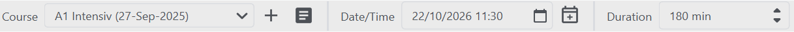

# Lesson info
The toolbar at the top of the editor holds the details of the lesson you are planning: the course, the date and time, and the duration. Use these to link a document to a course and to schedule it.

## Selecting a course
To link the document to a course, choose it from the **Course list**. Type in the list to search by course name or by the name of a student in the course. Quickly add a new your course with the **+** button or show the course's student list with <svg xmlns="http://www.w3.org/2000/svg" height="18px" viewBox="0 0 25 20" width="18px" fill="#e3e3e3"><path d="M0 0h24v24H0z" fill="none"/><path d="M19 3H5c-1.1 0-2 .9-2 2v14c0 1.1.9 2 2 2h14c1.1 0 2-.9 2-2V5c0-1.1-.9-2-2-2zm-5 14H7v-2h7v2zm3-4H7v-2h10v2zm0-4H7V7h10v2z"/></svg>.

{: .note}
Selecting a course sets the Duration to the course's default length. You can change it for this lesson.

{: .note}
If you open a file whose course isn't in your list, for example a file from a colleague, Teachart asks whether you want to add the course.

## Schedules
If you set a schedule you can quickly open the document file from the startup window on the set date and time. To do that set your desired date and time and click on  <svg xmlns="http://www.w3.org/2000/svg" height="18px" viewBox="0 0 24 20" width="18px" fill="#e3e3e3"><path d="M0 0h24v25H0V0z" fill="none"/><path d="M19 3h-1V1h-2v2H8V1H6v2H5c-1.1 0-2 .9-2 2v14c0 1.1.9 2 2 2h14c1.1 0 2-.9 2-2V5c0-1.1-.9-2-2-2zm0 16H5V9h14v10zM5 7V5h14v2H5zm6.25 4v2.25H9v1.5h2.25v2.25h1.5v-2.25h2.25v-1.5h-2.25V11z"/></svg> (Schedule). Save the file. The schedule is created when you save.

{: .note }
You can change the **time format** between 12h and 24h in the settings.

{: .note}
You can recognize a scheduled file by the icon with the checkmark of the "Schedule" button: <svg xmlns="http://www.w3.org/2000/svg" height="18px" viewBox="0 0 24 20" width="18px" fill="#e3e3e3"><path d="M0 0h24v24H0V0z" fill="none"/><path d="M19 3h-1V1h-2v2H8V1H6v2H5c-1.1 0-2 .9-2 2v14c0 1.1.9 2 2 2h14c1.1 0 2-.9 2-2V5c0-1.1-.9-2-2-2zm0 16H5V9h14v10zM5 7V5h14v2H5zm5.56 10.46l5.93-5.93-1.06-1.06-4.87 4.87-2.11-2.11-1.06 1.06z"/></svg>.

{: .note}
If you want to automatically schedule any lesson activate "Always schedule lesson" in the settings.