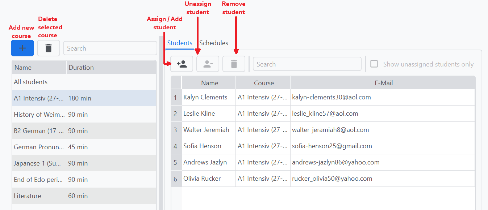
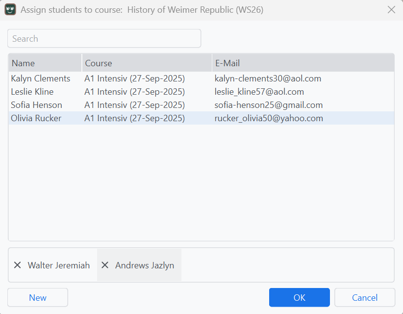
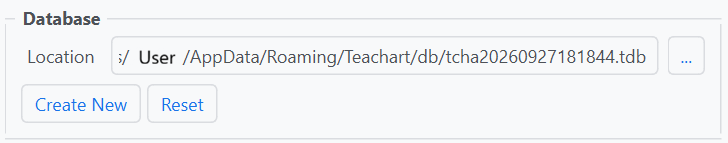

# Course Explorer
The Course Explorer is where you manage your courses, the students in them and your lesson schedules. Open it from the start window or from the **Options** menu in the editor.

Teachart stores courses, students and schedules in a database. When you link a document to a course, the document uses the course's name and default duration. See [Lesson info](https://deatorfm.github.io/Teachart/lesson_information.html).

**Assign / Add student**: Opens the assignment dialog, see below.
**Unassign student**: Takes the selected student out of the course. The student stays in your database.
**Remove student**: Deletes the student from the database.

## Courses
The list on the left shows your courses with their name and default lesson duration. All students at the top of the list shows every student. Click  + to add a course. Select a course and click the bin button to delete it. 

{: .important}
Deleting a course will not delete assigned students but unassign them.

## Assign students to a course
1. Select the course in the course list.
2. Click **Assign student** <svg xmlns="http://www.w3.org/2000/svg" height="18px" viewBox="0 0 24 20" width="18px" fill="#e3e3e3"><path d="M0 0h24v24H0V0z" fill="none"/><path d="M15 12c2.21 0 4-1.79 4-4s-1.79-4-4-4-4 1.79-4 4 1.79 4 4 4zm-9-2V8c0-.55-.45-1-1-1s-1 .45-1 1v2H2c-.55 0-1 .45-1 1s.45 1 1 1h2v2c0 .55.45 1 1 1s1-.45 1-1v-2h2c.55 0 1-.45 1-1s-.45-1-1-1H6zm9 4c-2.67 0-8 1.34-8 4v1c0 .55.45 1 1 1h14c.55 0 1-.45 1-1v-1c0-2.66-5.33-4-8-4z"/></svg>. The "Assign students to course" dialog opens. It lists the students who are unassigned or in another course.
3. Double-click a student to add them to the list at the bottom of the dialog. Use Search to find a student by name.
4. Click OK to assign everyone in the bottom list to the course.

To take a student off the list again, click the X next to their name. The student isn't deleted. They are just not assigned when you click OK.

Click on **New** to add a new student that is not on the list.

{: .note }
You can also change a student's course in the **Students** tab: double-click the student's Course cell and choose another course from the list.

{: .note }
To see only the students without a course, select **All students** in the course list and turn on **Show unassigned students only**.

## Reset/Change database
Teachart keeps your courses, students and schedules in a database file (.tdb). In the settings, the **Database** section shows where this file is stored. You can

- Use a different database: Click **…** next to Location and choose a .tdb file.
- Start with an empty database: Click **Create New** to create a new file and switch to it. Your old file stays on disc.
- Empty the current database: Click **Reset** to delete all data in the current file.

{: .note }
Users who move to a different computer can copy the database file and use it on the other computer.
