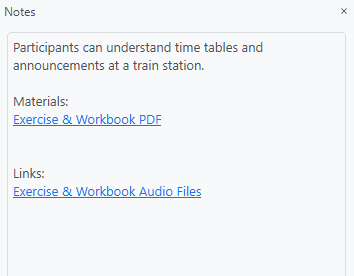

# Notes
The notes panel on the right side of the editor holds information about the whole sheet, such as the lesson goal, the materials you need and links to resources. Links to websites and local files can be opened directly from the notes.

Click <svg xmlns="http://www.w3.org/2000/svg" viewBox="0 0 24 20" height="18px" width="18px" fill="#e3e3e3"><path d="M3,18V16H15v2H3Zm0-5V11H21v2H3ZM3,8V6H21V8H3Z"/></svg> (Show/Hide notes) to open and close the notes panel.

{: .important}
The notes panel is for simple notes and to collect files and websites used for the lessons. For simplicity text cannot be formatted.

## Add hyperlinks
You can type plain text in the notes and add links in two ways:
- Website: Copy the address and paste it into the notes.
- Local file: Drag the file from your file manager and drop it onto the notes panel.

Click on the link to open the website/file.

{: .warning}
If the file is removed or moved the link will not work anymore.