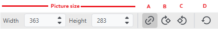
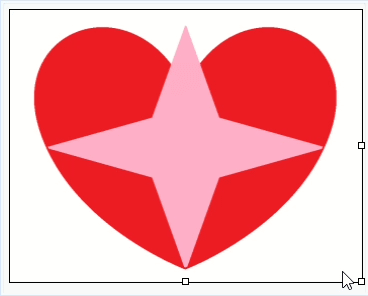

# Picture Element
The picture element shows an image in a cell. To add one, click **Add to cell** in the cell editor toolbar, choose Picture and select an image file. Click the picture to open the element editor, where the toolbar lets you resize and rotate it.

**Picture size**: The Width and Height fields set the picture's size.\
**Keep aspect ratio (A)**: When selected keeps the aspect ratio when changing the size\
**Rotate right (B)**: Rotates the picture 90° clockwise\
**Rotate left (C)**: Rotates the picture 90° counterclockwise\
**Restore original size (D)**: Resets the picture to its original proportions and fits it to the column width.

## Changing picture size
By default, a picture fills the width of its column. When you change the column width, the picture scales with it and keeps its proportions.

To make a picture smaller than its column, use either of these:
- Enter a new Width or Height in the toolbar.
- Drag the square handles on the right and bottom edges of the picture frame.

To keep the aspect ratio <svg xmlns="http://www.w3.org/2000/svg" width="18" height="18" viewBox="0 0 24 20" fill="#e3e3e3"><path d="M18.3643 15.5353L16.95 14.1211L18.3643 12.7069C20.3169 10.7543 20.3169 7.58847 18.3643 5.63585C16.4116 3.68323 13.2458 3.68323 11.2932 5.63585L9.87898 7.05007L8.46477 5.63585L9.87898 4.22164C12.6127 1.48797 17.0448 1.48797 19.7785 4.22164C22.5121 6.95531 22.5121 11.3875 19.7785 14.1211L18.3643 15.5353ZM15.5358 18.3638L14.1216 19.778C11.388 22.5117 6.9558 22.5117 4.22213 19.778C1.48846 17.0443 1.48846 12.6122 4.22213 9.87849L5.63634 8.46428L7.05055 9.87849L5.63634 11.2927C3.68372 13.2453 3.68372 16.4112 5.63634 18.3638C7.58896 20.3164 10.7548 20.3164 12.7074 18.3638L14.1216 16.9496L15.5358 18.3638ZM14.8287 7.75717L16.2429 9.17139L9.17187 16.2425L7.75766 14.8282L14.8287 7.75717Z"></path></svg> (A) must be activated when using the toolbar or the hold the shift key when using the nodes.

{: .important }
If you make a column narrower than the picture, Teachart discards the size you set manually and fits the picture to the new column width.
