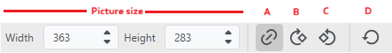
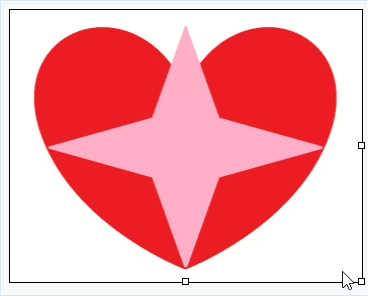

# Picture Element
If you want to have a picture shown in your document choose **Picture** from the **Add to cell** menu and select an image file. You can then transform the picture using the tool bar.

**Keep aspect ratio (A)**: Keeps the aspect ratio when changing the size\
**Rotate right (B)**: Rotates the picture 90° to the right\
**Rotate left (C)**: Rotates the picture 90° to the left\
**Restore original size (D)**: Reset's picture original aspect ratio and resize to column width

## Changing picture size
The size of the picture can be transformed in different ways. By default the picture's size is determined by the column's width. Changing the column's width also changes the picture's size keeping the current ratio.

To resize the picture to dimension smaller than the column's width you either change the width and height numbers in the tool bar or cick and drag the square nodes at the right and bottom of the picture frame.

To keep the aspect ratio <svg xmlns="http://www.w3.org/2000/svg" width="18" height="18" viewBox="0 0 24 20" fill="#e3e3e3"><path d="M18.3643 15.5353L16.95 14.1211L18.3643 12.7069C20.3169 10.7543 20.3169 7.58847 18.3643 5.63585C16.4116 3.68323 13.2458 3.68323 11.2932 5.63585L9.87898 7.05007L8.46477 5.63585L9.87898 4.22164C12.6127 1.48797 17.0448 1.48797 19.7785 4.22164C22.5121 6.95531 22.5121 11.3875 19.7785 14.1211L18.3643 15.5353ZM15.5358 18.3638L14.1216 19.778C11.388 22.5117 6.9558 22.5117 4.22213 19.778C1.48846 17.0443 1.48846 12.6122 4.22213 9.87849L5.63634 8.46428L7.05055 9.87849L5.63634 11.2927C3.68372 13.2453 3.68372 16.4112 5.63634 18.3638C7.58896 20.3164 10.7548 20.3164 12.7074 18.3638L14.1216 16.9496L15.5358 18.3638ZM14.8287 7.75717L16.2429 9.17139L9.17187 16.2425L7.75766 14.8282L14.8287 7.75717Z"></path></svg> (A) must be activated when using the toolbar or the shift key must be hold when using the nodes.

{: .important }
Resizing the column to a smaller width than the image's size will reset the user's manually defined size. 
