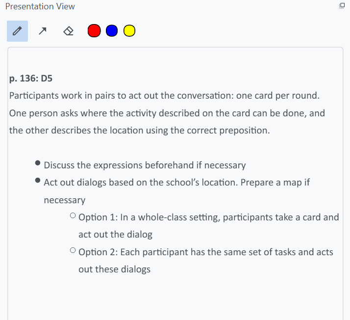
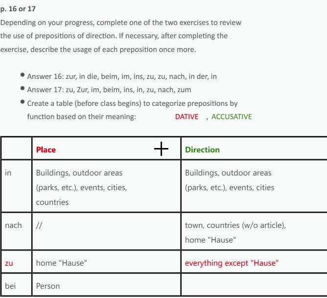

# Presentation mode
Presentation mode shows the content of one element from your table on a second screen, for example a text or a picture, so your students can see it. You can draw on the content while it is displayed, to point things out.

Activate presentation mode by choosing the option from the **View** menu or the toolbar <svg xmlns="http://www.w3.org/2000/svg" enable-background="new 0 0 24 20" height="18px" viewBox="0 0 24 24" width="18px" fill="#e3e3e3"><g><rect fill="none" height="24" width="24"/></g><g><g><g><path d="M21,3H3C1.9,3,1,3.9,1,5v8h2V5h18v16c1.1,0,2-0.9,2-2V5C23,3.9,22.1,3,21,3z"/></g><g><path d="M13,10c0-2.21-1.79-4-4-4s-4,1.79-4,4c0,2.21,1.79,4,4,4S13,12.21,13,10z M7,10c0-1.1,0.9-2,2-2s2,0.9,2,2 c0,1.1-0.9,2-2,2S7,11.1,7,10z"/></g><g><path d="M15.39,16.56C13.71,15.7,11.53,15,9,15c-2.53,0-4.71,0.7-6.39,1.56C1.61,17.07,1,18.1,1,19.22V22h16v-2.78 C17,18.1,16.39,17.07,15.39,16.56z M15,20H3c0-0.72-0.1-1.34,0.52-1.66C4.71,17.73,6.63,17,9,17c2.37,0,4.29,0.73,5.48,1.34 C15.11,18.66,15,19.29,15,20z"/></g></g></g></svg>, or use the shortcut F11. You can turn off presentation mode the same way.

Connect a second screen first. The selected element is then shown on it in full screen. If you disconnect the screen, presentation mode turns off automatically.

While in presentation mode selecting an element showes it in on the presentation screen. Some elements like the audio element cannot be presented.

{: .important }
Turning on presentation mode without a second screen connected will only show the "Presenation Viewe" panel.

## Drawing
The "Presentation View" panel on the right side of the editor mirrors what the audience sees. To draw on the content, choose a tool and a colour in this panel, then draw on the preview. Your drawing appears on the second screen at the same time.

- **Pen**: Draw freehand lines.
- **Arrow**: Draw an arrow. See below.
- **Eraser**: Remove drawn lines and arrows.

{: .important}
The drawing is not permanent and is deleted when presentation mode is turned off or the element is changed.

{: .note }
The eraser removes one line or arrow at a time. It does not erase parts of a line.

### Arrow tool
To draw an arrow, click where it should start, drag to where it should point, and release the mouse button. The arrow is drawn when you release.

