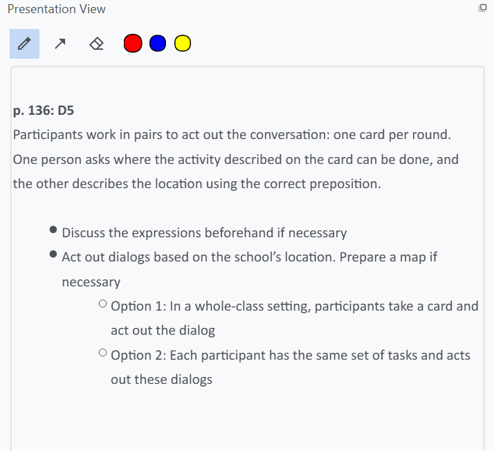
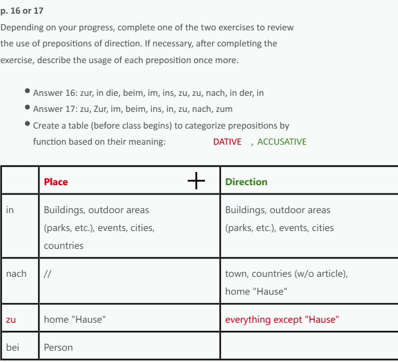

# Presentation mode
Presentation mode allows you to present elements from the table on a second screen similar to presentation programms you know. You've also got the option to draw on the content.

Activate presentation mode by choosing the option from the **View** menu or the tool bar <svg xmlns="http://www.w3.org/2000/svg" enable-background="new 0 0 24 20" height="18px" viewBox="0 0 24 24" width="18px" fill="#e3e3e3"><g><rect fill="none" height="24" width="24"/></g><g><g><g><path d="M21,3H3C1.9,3,1,3.9,1,5v8h2V5h18v16c1.1,0,2-0.9,2-2V5C23,3.9,22.1,3,21,3z"/></g><g><path d="M13,10c0-2.21-1.79-4-4-4s-4,1.79-4,4c0,2.21,1.79,4,4,4S13,12.21,13,10z M7,10c0-1.1,0.9-2,2-2s2,0.9,2,2 c0,1.1-0.9,2-2,2S7,11.1,7,10z"/></g><g><path d="M15.39,16.56C13.71,15.7,11.53,15,9,15c-2.53,0-4.71,0.7-6.39,1.56C1.61,17.07,1,18.1,1,19.22V22h16v-2.78 C17,18.1,16.39,17.07,15.39,16.56z M15,20H3c0-0.72-0.1-1.34,0.52-1.66C4.71,17.73,6.63,17,9,17c2.37,0,4.29,0.73,5.48,1.34 C15.11,18.66,15,19.29,15,20z"/></g></g></g></svg>, or use the short cut F11. If you have a second screen connected to your computer the contents of the selected element is displayed there in full screen. If you disconnect the screen, presentation mode is automatically turned off.

## Drawing
To draw on the displayed content you use the area that is shown on the right hand side mirroring the presentation screen. Select the tool (pen, rubber, arrow) and draw on the area. 

### Arrow tool
The arrow tool is used by clicking and dragging the mouse to the point where you want to tip pointed to. Letting off the mouse button will then draw the arrow.

{: .notes }
The rubber tool can only delete single contiguously drawn lines and arrows.
