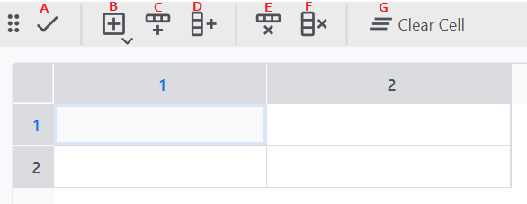
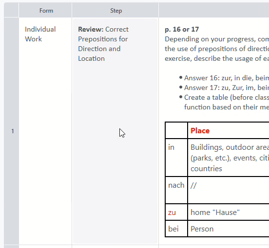
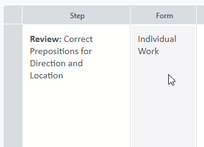
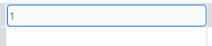
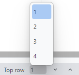

# Table

Clicking on a cell activates the cell editor which enables the tool bar above. You can also find all option in the menu **Edit**. To close the editor click on the checkmark (A) or press Enter.

## Cells and elements
A table is made up of rows and columns of cells. Each cell can hold one or more elements, such as text, images or audio. Take a look at the [element guide](https://deatorfm.github.io/Teachart/elements.html) to see what kind of elements are available in the latest version. Cells and elements have their own editing mode.
- The **cell editor** works on the cell as a whole: its elements, and copying or clearing it.
- The **element editor** edits a single element, for example the text inside it.

Take a look at the status bar in the bottom right to see which editor is open*.

*\*Available since version 1.0.0-b.110*

{: .note }
To open the element editor directly, hold Ctrl and click the element. To make this the default behavior without holding Ctrl you can activate the setting **Always select single elements of cell**.

## Adding and removing rows and columns

**Insert row** (C): Adds a row under the selected cell.\
**Insert column** (D): Adds a column to the right of the selected cell.\
**Remove row** (E): Removes the row of the selected cell.\
**Remove column** (F): Removes the column of the selected cell. 

{: .note}
To add a row or column at the end of the table, use **Append row** (Ctrl + R) or **Append column** (Ctrl + T) from the Edit menu.

## Remove entire cell content
Select a cell and click on **Clear Cell** (G).

## Copying and pasting cells
You can copy whole cells and paste them into another cell including a cell of a different document. Use **Copy** (Ctrl + C) and **Paste** (Ctrl + V) in the **Edit** menu.\
\
If the target cell already has content, Teachart asks whether to **overwrite** it or **append** the copied content to it.

{: .important}
While the element editor is open, **Copy** copies only that element, not the cell. To copy the whole cell, close the element editor first.

## Swapping cells
Close the cell and element editors first. Then click and hold a cell, drag it onto the cell you want to swap with, and release the mouse button.

## Moving rows and columns
Like single cells you can move entire rows or columns by drag & dropping. Click and a row or column header and move it to the desired position.

## Changing header text
Double-click a column header to rename it. Type the new text and press **Enter** to save.

## Scrolling by row or column
To scroll through the table one row or column at a time, hold Ctrl and press the arrow keys. To jump to a specific row, choose its number from "Top row" in the status bar. 

