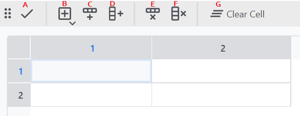
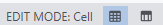
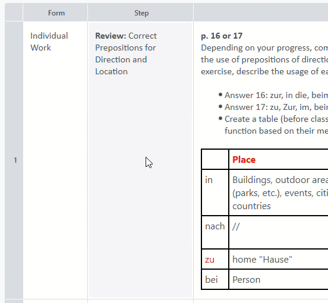
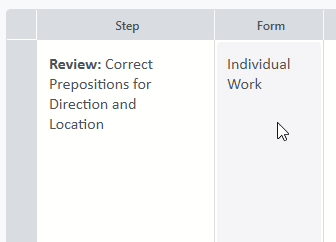
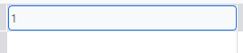
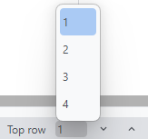

# Table

Clicking on a cell activates the cell editor which enables the tool bar above. You can also find all option in the menu "Edit" as well. To close the editor click on the checkmark (A) or press Enter.

## Cells and elements
Table rows x columns cell and in each cell you can insert elemens. Elements can be text, images or audio. Take a look at the element guide to see what kind of elements are available in the latest version. Cells and elements have their own editing mode. Take a look at the status bar in the bottom right to see which editor is open*.

*Since version 1.0.0-b.110

## Adding and removing rows and columns

**Insert row** (C): Adds a row under the selected cell.\
**Insert column** (D): Adds a column to the right of the selected cell.\
**Remove row** (E): Removes the row of the selected cell.\
**Remove column** (F): Removes the column of the selected cell. 

{: .note}
You can also append rows and columns at either end of the table using the options "Append row" (Ctrl + R) and "Append column" (Ctrl + T). Use the keyboard shortcuts to quickly add them.

## Remove entire cell content
Select a cell and click on "Clear Cell" (G).

## Copying and pasting cells
You can copy whole cells and paste them into another cell even of a different document. Use "Copy" (Ctrl + C) and "Paste" (Ctrl + V) in the "Edit" menu or use the usual shortcuts.\
\
If you paste into a cell that has already content you have the option to overwrite the contents of the cell or append the copied contents to the cell.

{: .important}
If your are editing an element and use "Copy" the single element is copied and not the cell. Close the element editor first if you want to copy the whole cell.

## Swapping cells
Make sure no cell and element editors are not activated. Click the cell and hold the mouse button, then drag it on the cell you want to swap with.\

## Moving rows and columns
Like single cells you can move entire rows or columns by drag & dropping. Click and a row or column header and move it to the desired position.

## Changing header text
The text of horizontal headers can be customised by double clicking on a header. Change the text inside the text field and save your changes with Enter.

## Scrolling by row or column
You can quickly scroll through the table row by row or column by column by using Ctrl and the arrow keys.
You can also jump to a row by selecting the row number in the status bar.

