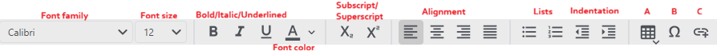

# Text Element
You can customize your document with formatted text using the text element. The editor can be used like a word processor. Besides formatted text you also have the options to insert tables and hyperlinks.

You can insert the following special text item:
- **Table** (A)
- **Symbol** (B)
- **Hyperlink** (C)

{: .important }
Some tool bar options might not visible if the window is too narrow. You can show these by clicking on **»**.

{: .note}
Text format options can also be changed in the right click menu\*.\
\*upcoming in 1.0.0-b.110*

## Tables
To insert a table click on <svg xmlns="http://www.w3.org/2000/svg" width="18" height="18" viewBox="0 0 24 20" fill="#e3e3e3"><path d="M4,3H20A2,2 0 0,1 22,5V20A2,2 0 0,1 20,22H4A2,2 0 0,1 2,20V5A2,2 0 0,1 4,3M4,7V10H8V7H4M10,7V10H14V7H10M20,10V7H16V10H20M4,12V15H8V12H4M4,20H8V17H4V20M10,12V15H14V12H10M10,20H14V17H10V20M20,20V17H16V20H20M20,12H16V15H20V12Z" /></svg> (A) and define an initial size using the grid. Click inside the table to use the table tool bar.

## Hyperlinks
Click on <svg xmlns="http://www.w3.org/2000/svg" enable-background="new 0 0 24 20" height="18px" viewBox="0 0 24 24" width="18px" fill="#e3e3e3"><g><rect fill="none" height="24" width="24"/></g><g><path d="M8,11h8v2H8V11z M20.1,12H22c0-2.76-2.24-5-5-5h-4v1.9h4C18.71,8.9,20.1,10.29,20.1,12z M3.9,12c0-1.71,1.39-3.1,3.1-3.1h4 V7H7c-2.76,0-5,2.24-5,5s2.24,5,5,5h4v-1.9H7C5.29,15.1,3.9,13.71,3.9,12z M19,12h-2v3h-3v2h3v3h2v-3h3v-2h-3V12z"/></g></svg>, enter a link and confirm with OK. If you like to change the text of the link select the link and type in a new text.