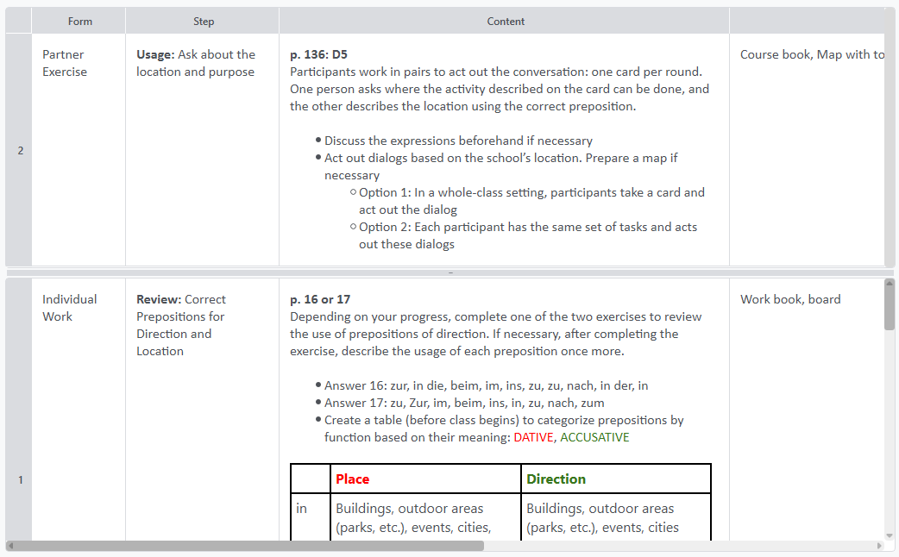

# View modes
The table offers different view modes to focus on certain areas e.g. during alesson. These view modes can be accessed in the **View** menu or the bottom right of the status bar.

### Table mode
The default mode that displays a full table with all rows and columns always visible.

### Single row mode
Shows only one row at the time. You can change the rows by scrolling, using the arrow buttons in the status bar or the short cuts (*Ctrl + Arrow up/down*). 

{: .note}
Newly added rows under the visible row are automatically made invisible.

### Frozen row mode
This mode can only be accessed in the **"**View**"** menu. Select any cell of the row you want to freeze to the top of the table and select the "Freeze row" option in the view menu. To unfreeze select a cell of the frozen row and choose **Unfreeze row** in the **View** menu.

The frozen row area can be resized with the grip at the bottom. The maximum size is half the table's size even if a row is larger than the table in height.

{: .note}
Adding a row under or over the frozen row will not make the new row frozen.

